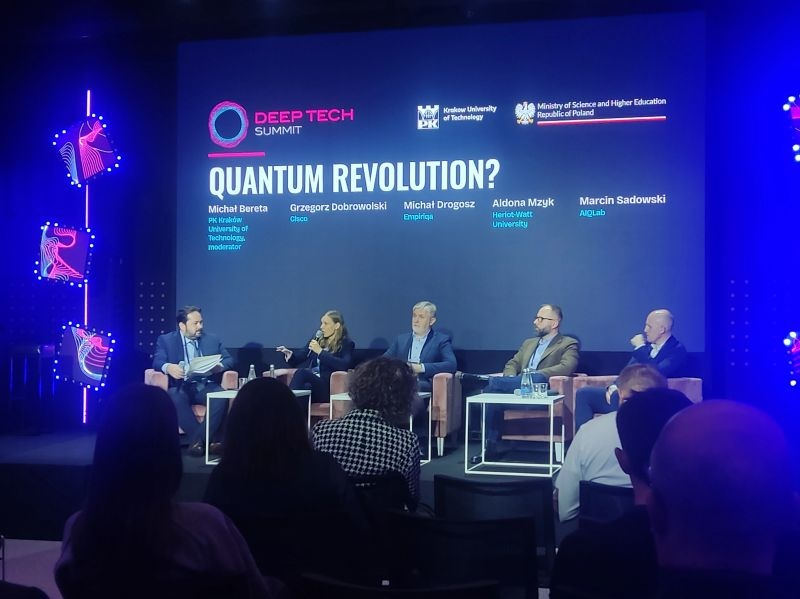
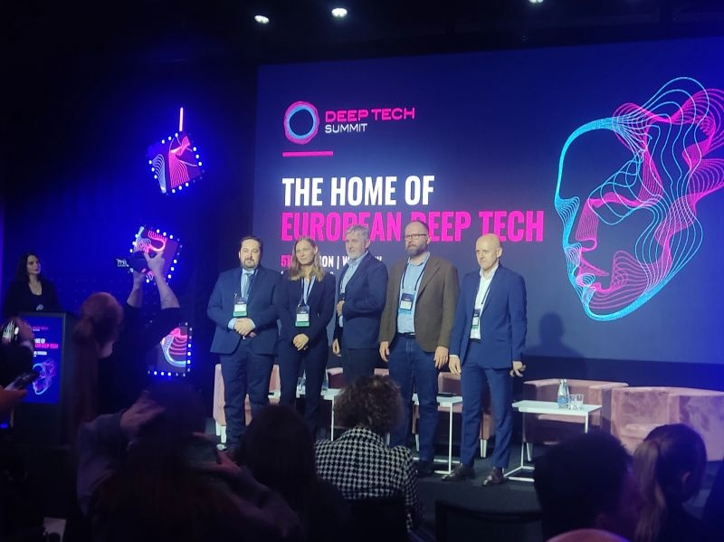
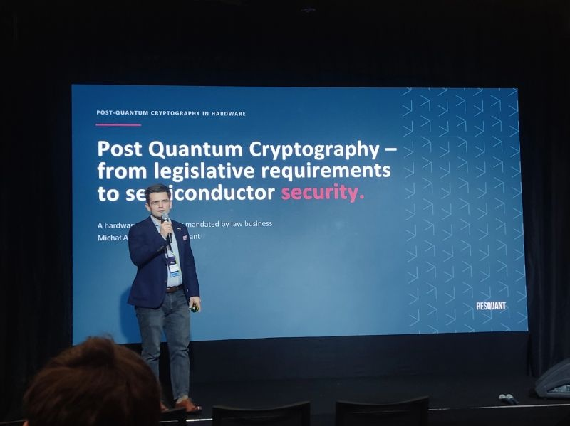
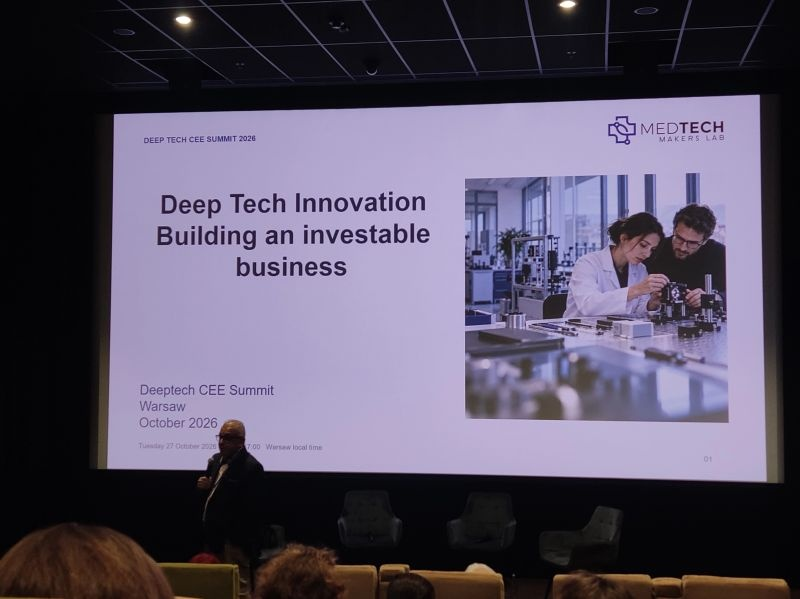

I've just wrapped up an intense and incredibly inspiring day at the Deep Tech Summit 2026 in Warsaw!

As a student, I spent the time soaking up knowledge at the intersection of science, engineering, and business. The conference once again highlighted the immense potential inherent in the European deep tech sector.  
I was particularly drawn to the panels on the quantum revolution and post-quantum cryptography. The challenges surrounding system migration and hardware security in the quantum era could have a profound impact on our modern digital world—and on how we safeguard our online security.  
It just goes to show that the world of technology never stands still; combining programming with groundbreaking engineering is definitely a path worth pursuing.

It was great to get an inside look at this ecosystem. A huge thank you to the speakers for such excellent, substantive discussions!

