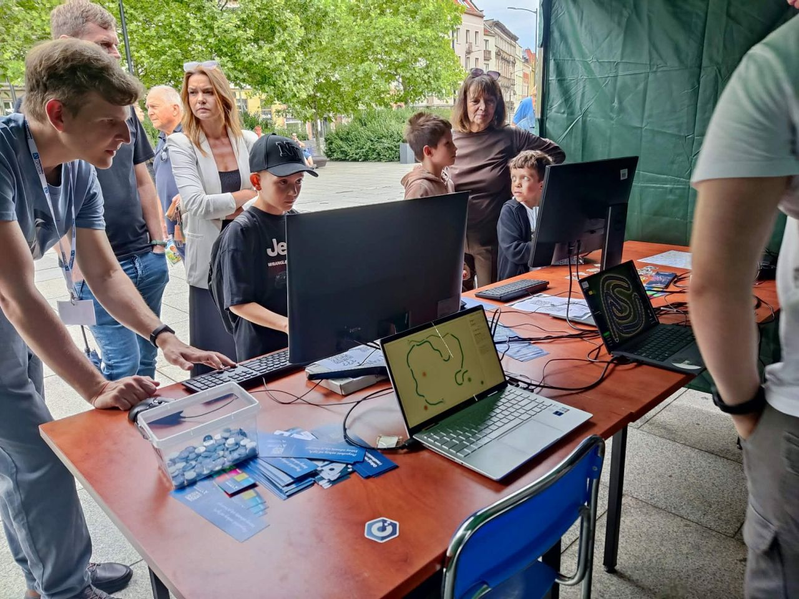
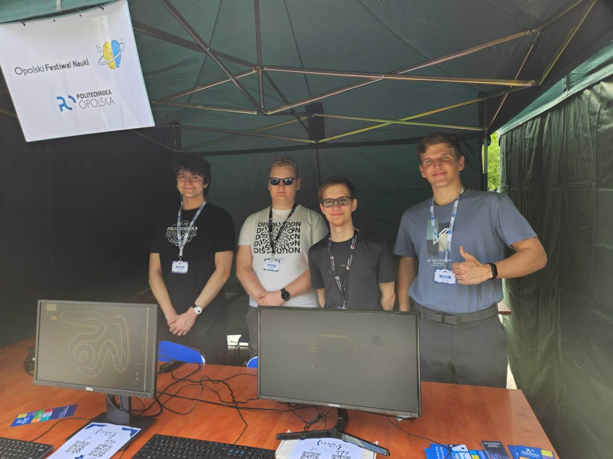

# Representing Opole University at the Science Picnic

I had the pleasure of representing our university at this year's Opole Science Picnic with the SKN TeamBit team. It was an intense time that showed how much emotion science can stir when you bring it directly to people.

## What we prepared

- **Interactive tech demo** — we showcased modern technical solutions, including neural networks in action, letting visitors see the potential of modern algorithms with their own eyes.
- **Gaming zone** — a station that attracted both younger and older fans of virtual entertainment, showing the technological backbone of the entertainment industry.

## The day

The event exceeded our expectations in attendance. Dozens of people passed through our stand — from kids fascinated by screens, through peers and other students, to seniors who approached the digital world with great openness.

The best part of the day was the direct contact with people: sharing passion, answering dozens of questions, and seeing genuine curiosity on visitors' faces.

Huge applause to the whole team for the joint work, great organization, and unwavering energy from the first to the last minute of the picnic. We showed that technology connects generations!

Collaborators: Jakub Kamionka, Yurii Holovko, Dawid Borowski.