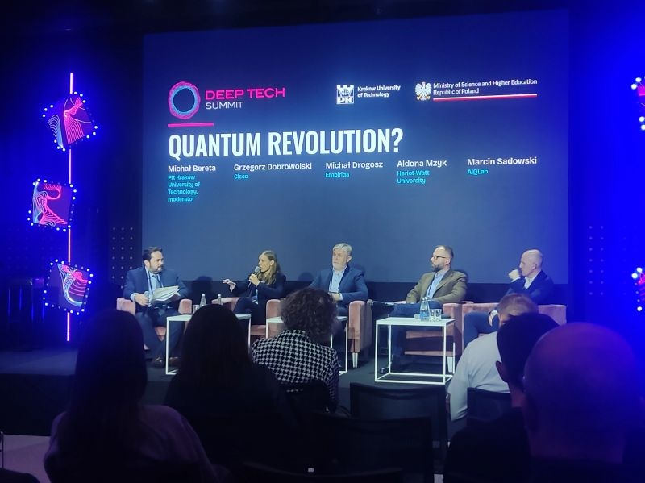
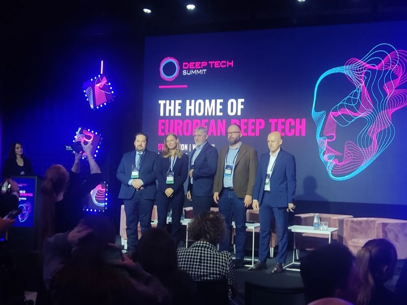
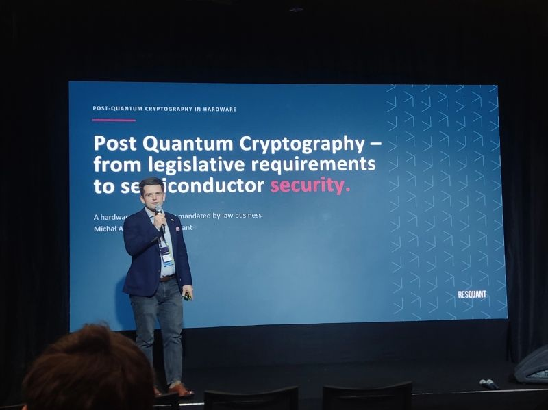
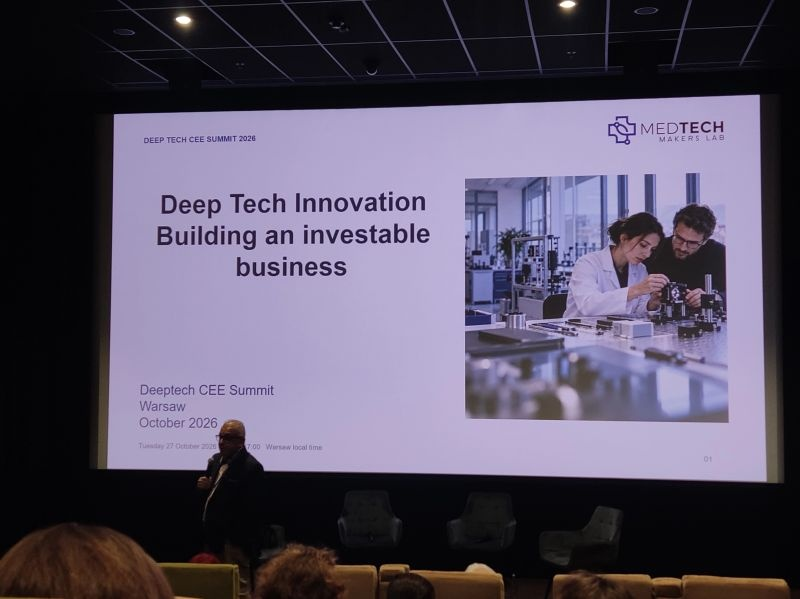

Za mną intensywny i niezwykle inspirujący dzień na Deep Tech Summit 2026 w Warszawie!

Jako student spędziłem ten czas, chłonąc wiedzę na styku nauki, inżynierii i biznesu. Konferencja po raz kolejny pokazała, jak potężny potencjał drzemie w europejskim deep techu.  
Moją uwagę szczególnie przykuły panele poświęcone rewolucji kwantowej i kryptografii postkwantowej. Wyzwania związane z migracją systemów oraz bezpieczeństwem sprzętowym w erze kwantowej mogą wywrzeć ogromny wpływ na współczesny świat cyfrowy i to, jak chronimy nasze bezpieczeństwo w sieci.  
To tylko pokazuje, że świat technologii nie stoi w miejscu, a połączenie programowania z przełomową inżynierią to kierunek, w którym zdecydowanie warto się rozwijać.

Fajnie było zobaczyć ten ekosystem od środka. Wielkie dzięki dla prelegentów za świetne, merytoryczne dyskusje!

