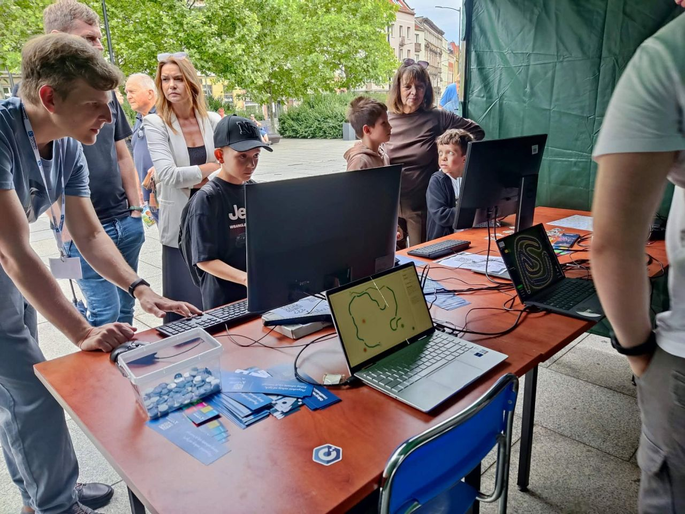
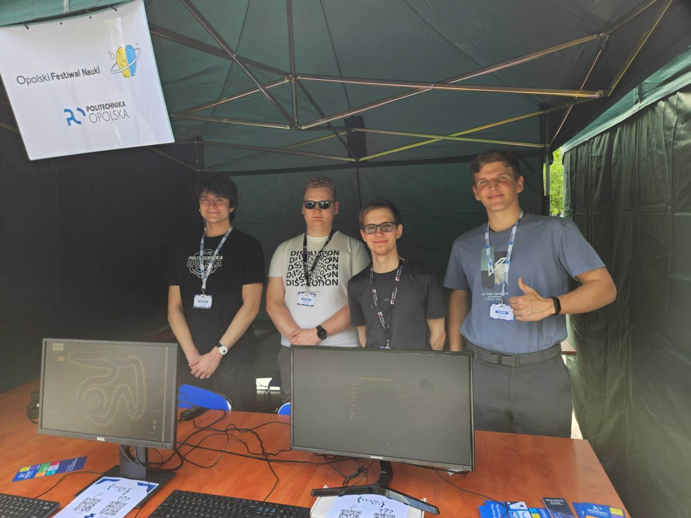

# Reprezentowanie Politechniki Opolskiej na Pikniku Nauki

Miałem przyjemność reprezentować naszą uczelnię podczas tegorocznego Opolskiego Pikniku Nauki z zespołem SKN TeamBit. To był niezwykle intensywny czas, który pokazał, jak wielkie emocje potrafi wzbudzić nauka, gdy wyjdzie się z nią prosto do ludzi.

## Co przygotowaliśmy

- **Interaktywne demo technologiczne** — prezentowaliśmy najnowsze rozwiązania techniczne, w tym sieci neuronowe w akcji, pozwalając każdemu na własne oczy zobaczyć potencjał współczesnych algorytmów.
- **Strefa gier** — stanowisko, które przyciągało zarówno młodszych, jak i starszych fanów wirtualnej rozrywki, pokazując technologiczne zaplecze branży rozrywkowej.

## Dzień wydarzenia

Samo wydarzenie przerosło nasze oczekiwania pod względem frekwencji. Przez nasze stanowisko przewinęły się dziesiątki osób — od dzieciaków zafascynowanych ekranami, przez rówieśników i innych studentów, aż po seniorów, którzy z ogromną otwartością podchodzili do cyfrowego świata.

Najlepsza część tego dnia? Zdecydowanie bezpośredni kontakt z ludźmi. Możliwość podzielenia się swoją pasją, odpowiedzenia na dziesiątki pytań i zobaczenia autentycznego zaciekawienia na twarzach odwiedzających daje ogromnego kopa do dalszego działania.

Wielkie brawa dla całej ekipy za wspólną pracę, świetną organizację i niesłabnącą energię od pierwszej do ostatniej minuty pikniku. Pokazaliśmy, że technologia łączy pokolenia! 🤝

[Jakub Kamionka](https://www.linkedin.com/in/jakubkamionka/), [Yurii Holovko](https://www.linkedin.com/in/yurii-holovko/), [Dawid Borowski](https://www.linkedin.com/in/dawidborowski/).